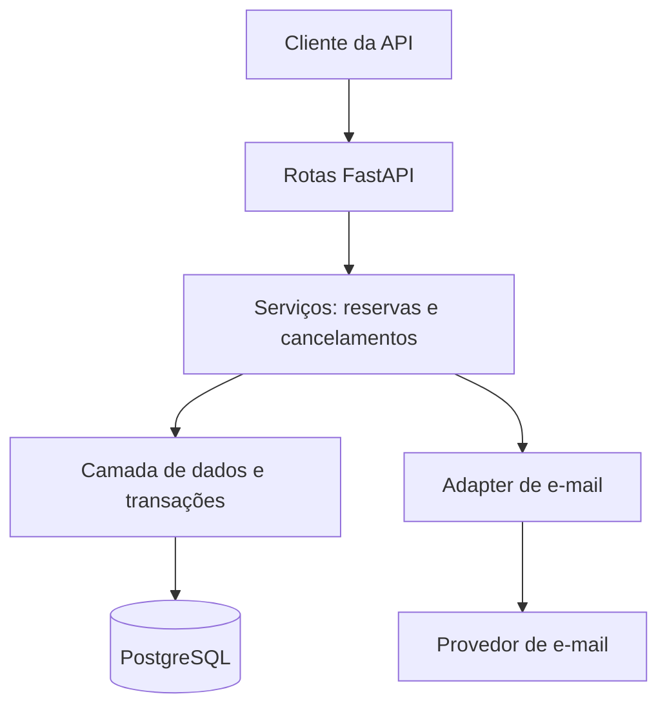

# Arquitetura do CondoFit

Status: **Aprovada em 16/11/2026**. Decisões e justificativas: [ADR-001](adr/ADR-001-arquitetura.md).

## Diagrama de blocos

O cliente representa uma ferramenta que envia requisições HTTP à API. As setas indicam chamadas, e as respostas retornam pelo mesmo caminho. As consultas passam por rotas, serviços e dados, sem envio de e-mail. Esta entrega abrange o planejamento do backend.

## Responsabilidades e organização prevista

| Módulo previsto | Responsabilidade |
| --- | --- |
| `app/main.py` | Criar e configurar a aplicação. |
| `app/rotas.py` | Receber entradas, identificar solicitante e produzir respostas HTTP. |
| `app/schemas.py` | Definir formatos das entradas e saídas. |
| `app/servicos.py` | Aplicar as regras e coordenar os casos de uso. |
| `app/dados.py` | Consultas, persistência, conexão e transações PostgreSQL. |
| `app/email_adapter.py` | Traduzir a confirmação para o provedor de e-mail. |
| `tests/` | Testes unitários e de integração. |

Planejamos essa estrutura para a implementação. A divisão adicional de módulos ocorrerá somente quando melhorar a leitura ou a manutenção. Conexões com banco de dados e provedor de e-mail não serão abertas durante a importação dos módulos.

## Regras confirmadas para orientar a implementação

| ID | Regra |
| --- | --- |
| RN-ARQ-01 | Uma reserva ativa por apartamento e dia, considerando todos os moradores desse apartamento. |
| RN-ARQ-02 | Cada reserva dura exatamente uma hora. |
| RN-ARQ-03 | Cancelar permite reservar novamente para o mesmo dia; a cancelada permanece no histórico e não conta para o limite. |
| RN-ARQ-04 | Apartamentos diferentes podem reservar o mesmo horário, sem limite de pessoas por período. |
| RN-ARQ-05 | A reserva é consultável por data e gera confirmação por e-mail. |
| RN-ARQ-06 | A disponibilidade indica se o apartamento pode reservar segundo as regras de agendamento; a ocupação do horário por outros apartamentos não impede a reserva. |

Utilizamos os identificadores RN-ARQ nas [histórias de usuário](../specs/historias-arquiteto.md) para relacionar os fluxos às regras de negócio. Os [requisitos não funcionais de arquitetura](../specs/requisitos-arquitetura.md) possuem identificadores e critérios próprios.

## Fluxo de reserva

1. A rota valida o formato dos dados e recebe a identidade verificada do solicitante, conforme o mecanismo de autenticação definido na spec. O apartamento usado na reserva deve corresponder ao vínculo desse morador, e não apenas a um identificador livre informado na requisição.
2. O serviço verifica apartamento, duração, dia e condições de agendamento definidas na spec.
3. A camada de dados grava e confirma a transação. A unicidade parcial protege o limite diário mesmo em concorrência.
4. Havendo conflito, nenhuma segunda reserva é criada. A transação é revertida e a API explica a recusa.
5. Após persistir, o serviço solicita a confirmação ao Adapter de e-mail. Se o envio falhar, a reserva permanece válida e a falha é registrada sem dados sensíveis. Não informar sucesso de envio nem criar uma segunda reserva para tentar corrigir essa falha.
6. A reserva fica disponível na consulta por data. Não há integração com calendário externo prevista.

No cancelamento, verificar a autorização antes de alterar a reserva: um morador somente pode cancelar uma reserva do apartamento ao qual está vinculado. A alteração confirmada no banco libera o limite diário. Repetir o cancelamento não apaga o histórico nem cria uma nova reserva.

## Dados conceituais mínimos

- Apartamento: identificador próprio, bloco e número; não usar apenas o número para distinguir apartamentos de blocos diferentes.
- Morador: identificador, vínculo com apartamento e e-mail para confirmação. O cadastro e a autenticação são responsabilidades da aplicação e seguem os requisitos de acesso.
- Reserva: identificador, apartamento, morador solicitante, data local, início, fim e estado ativa/cancelada.

Os exemplos e testes utilizarão dados fictícios. O esquema físico e as migrações pertencem à etapa de implementação.

## O que o diagrama não diz

O diagrama não define tabelas, endpoints, códigos HTTP, política de autenticação, protocolo de e-mail, limites de tempo, transações ou implantação. Ele também não mostra o retorno das chamadas nem garante desempenho ou consistência por si só. Regras estão na spec; decisões arquiteturais no ADR; resultados esperados no plano de testes.

## Rastreabilidade

As [histórias de usuário](../specs/historias-arquiteto.md) descrevem os fluxos de reserva e cancelamento. Os [requisitos de arquitetura](../specs/requisitos-arquitetura.md) definem os critérios de isolamento e concorrência. A regra de responsabilidade pelo código integrado está no [AGENTS.md](../AGENTS.md).
