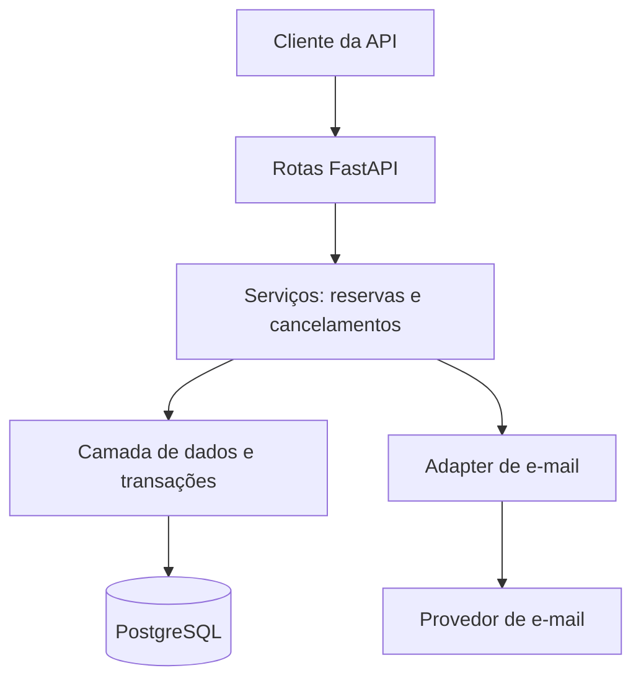

# Arquitetura do CondoFit

Status: proposta a revisar pelo grupo. Decisões e justificativas: [ADR-001](adr/ADR-001-arquitetura.md).

## Diagrama de blocos

O cliente pode ser uma ferramenta de requisições HTTP. Ele não representa um frontend a desenvolver nesta entrega. As setas representam chamadas; a resposta retorna pelo mesmo caminho. As operações de consulta seguem rotas, serviços e dados, sem envio de e-mail.

## Responsabilidades e organização prevista

| Módulo previsto | Responsabilidade |
| --- | --- |
| `app/main.py` | Criar e configurar a aplicação. |
| `app/rotas.py` | Receber entradas, identificar solicitante e produzir respostas HTTP. |
| `app/schemas.py` | Definir formatos das entradas e saídas. |
| `app/servicos.py` | Aplicar as regras e coordenar os casos de uso. |
| `app/dados.py` | Consultas, persistência, conexão e transações PostgreSQL. |
| `app/email_adapter.py` | Traduzir a confirmação para o provedor de e-mail. |
| `tests/` | Testes unitários e de integração. |

Essa estrutura é um planejamento, não código já criado. Dividir módulos somente quando houver necessidade real de leitura ou manutenção. Banco de dados e provedor não devem ser acessados na importação dos módulos.

## Regras confirmadas para orientar a implementação

| ID local | Regra |
| --- | --- |
| RN-ARQ-01 | Uma reserva ativa por apartamento e dia, considerando todos os moradores desse apartamento. |
| RN-ARQ-02 | Cada reserva dura exatamente uma hora. |
| RN-ARQ-03 | Cancelar permite reservar novamente para o mesmo dia; a cancelada permanece no histórico e não conta para o limite. |
| RN-ARQ-04 | Apartamentos diferentes podem reservar o mesmo horário, sem limite de pessoas por período. |
| RN-ARQ-05 | A reserva é consultável por data e gera confirmação por e-mail. |
| RN-ARQ-06 | A disponibilidade representa se o solicitante pode reservar segundo as regras, sem inventar lotação por horário. |

Estes IDs são referências locais para as duas histórias do arquiteto. O PO deve mapear essas regras aos RF/RNF oficiais na integração dos documentos.

## Fluxo de reserva

1. A rota valida o formato dos dados e recebe a identidade verificada do solicitante. A identificação segura ainda depende da definição de autenticação pelo grupo.
2. O serviço verifica apartamento, duração, dia e condições de agendamento definidas na spec.
3. A camada de dados grava e confirma a transação. A unicidade parcial protege o limite diário mesmo em concorrência.
4. Havendo conflito, nenhuma segunda reserva é criada. A transação é revertida e a API explica a recusa.
5. Após persistir, o serviço solicita a confirmação ao Adapter de e-mail. Uma falha de envio não deve causar duplicação da reserva; a política detalhada depende da aprovação do grupo.
6. A reserva fica disponível na consulta por data. Não há integração com calendário externo prevista.

No cancelamento, verificar a autorização antes de alterar a reserva. Somente uma reserva do apartamento identificado pode ser cancelada por seu morador. Essa é uma proposta de segurança a incorporar na spec. A alteração confirmada no banco libera o limite diário.

## Dados conceituais mínimos

- Apartamento: identificador próprio, bloco e número; não usar apenas o número para distinguir apartamentos de blocos diferentes.
- Morador: identificador, vínculo com apartamento e e-mail para confirmação. A forma de cadastro e autenticação será definida na spec.
- Reserva: identificador, apartamento, morador solicitante, data local, início, fim e estado ativa/cancelada.

Não armazenar dados reais de moradores em exemplos ou testes. Esquema físico e migrações serão definidos na implementação.

## O que o diagrama não diz

O diagrama não define tabelas, endpoints, códigos HTTP, política de autenticação, protocolo de e-mail, limites de tempo, transações ou implantação. Ele também não mostra o retorno das chamadas nem garante desempenho ou consistência por si só. Regras estão na spec; decisões arquiteturais no ADR; resultados esperados no plano de testes.

## Pontos a alinhar antes da implementação

PO: integrar os RF/RNF e definir funcionamento, fuso, identificação e cancelamento. Qualidade: incorporar os testes de isolamento e concorrência. Scrum Master: incluir estes arquivos no índice da entrega. O grupo aprova a arquitetura e indica o responsável humano de cada PR.
